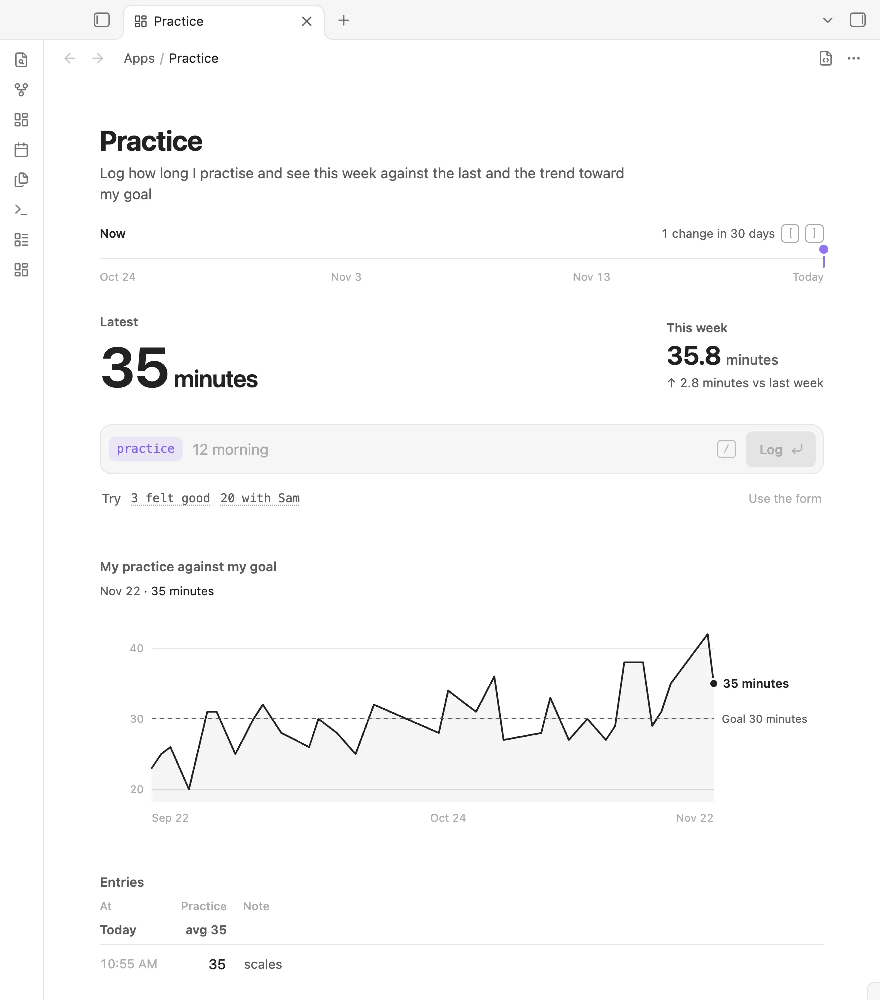
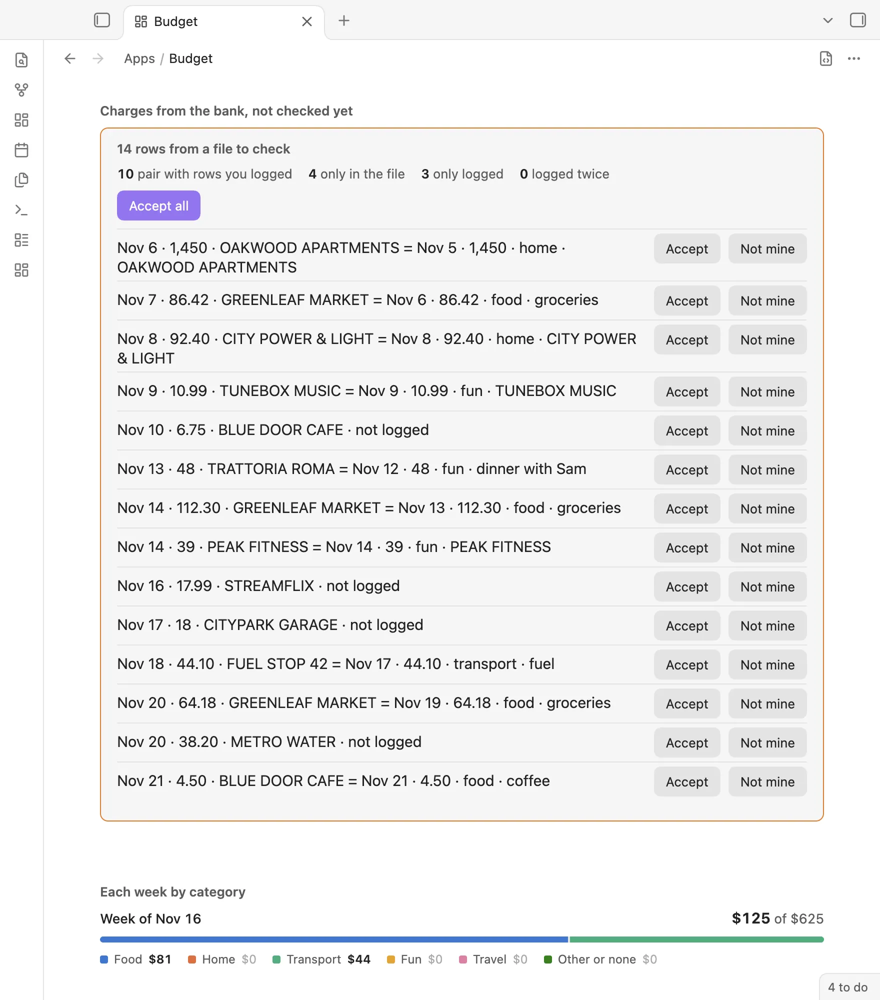
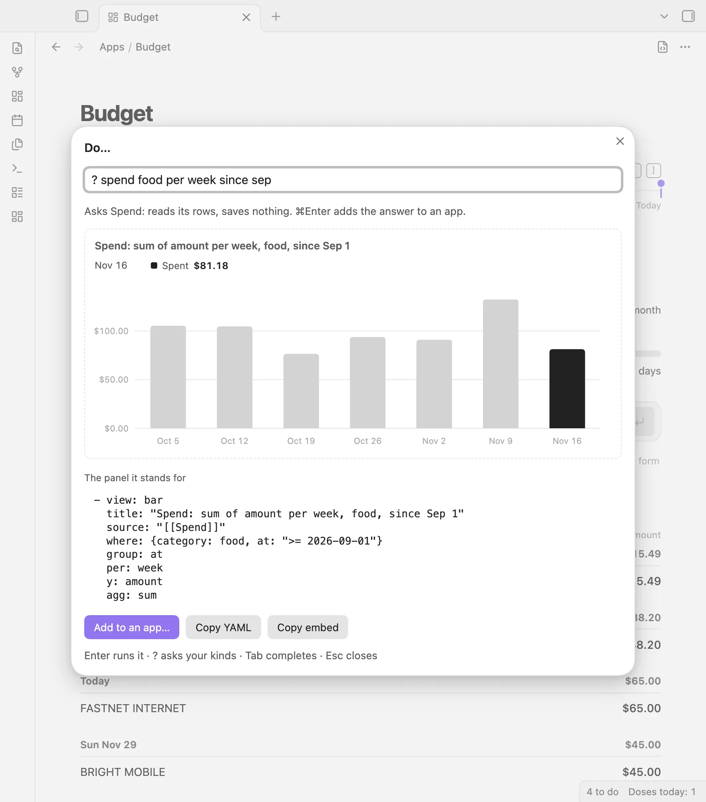
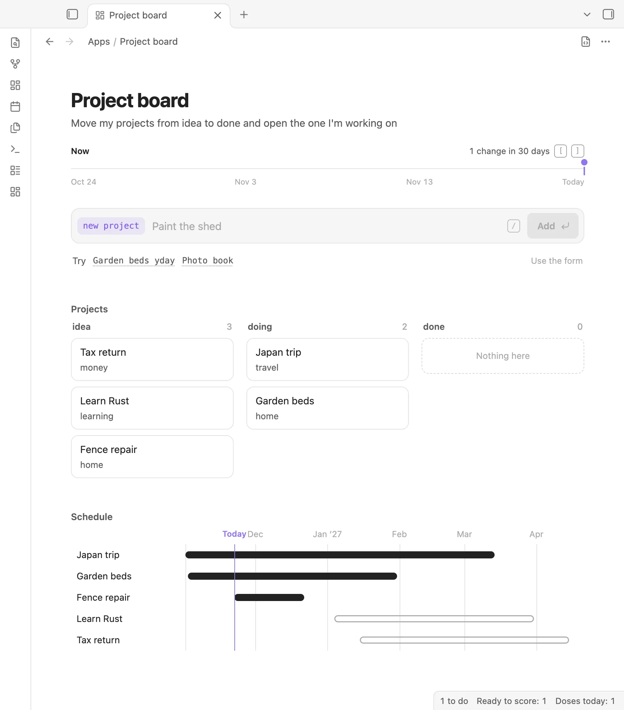
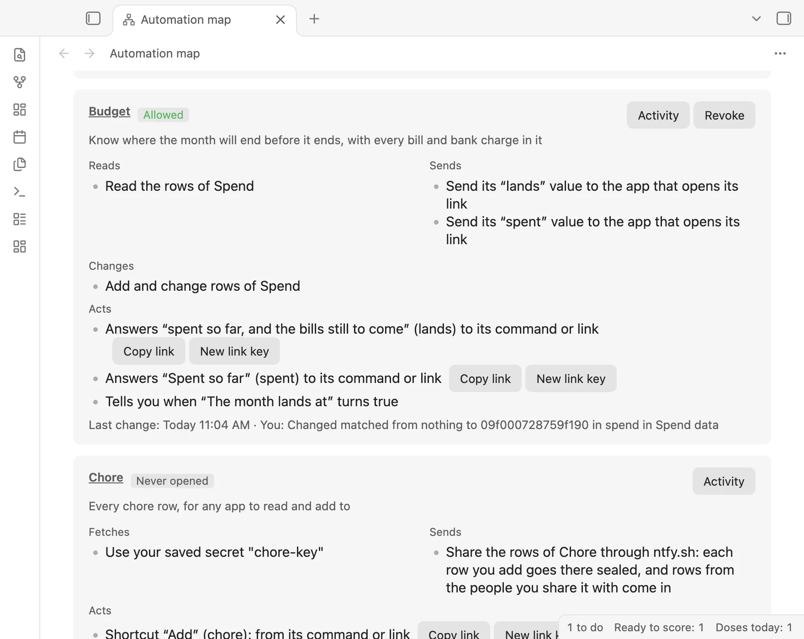

# Gizmo

**Type a few properties. Your note becomes an app.**

Gizmo is a plugin for Obsidian. It changes a note into a small app with buttons, forms, charts, boards and calendars. Your data stays in your vault, in notes that you can read. You do not write code.

```yaml
---
app: Log how long I practise and see this week against the last and the trend toward my goal
use: "[[Tracker kit]]"
with: {what: practice, unit: minutes, goal: 30}
---
```

These three lines make this app:

<picture>
  <source media="(prefers-color-scheme: dark)" srcset="https://raw.githubusercontent.com/chauduyphanvu/obsidian-gizmo/main/docs/images/practice-dark.webp">
  
</picture>

## Why Gizmo

- **One plugin, many apps.** Each new app is a note, not a new plugin.
- **No code.** You type each key by hand. Gizmo examines the keys and shows each problem in clear words.
- **Save a row one time.** A kind keeps rows for the full vault. Each app that reads the kind shows them.
- **Plan, then check.** A row can be planned for a day to come, or come from the export of your bank. **Next** asks about each thing that needs you.
- **Your data stays in your vault.** Gizmo keeps it in Markdown notes that Bases and Dataview can read, with a text log beside each note. There is no hidden database.
- **You give permission first.** An app tells you what it will read, download, send and change. It does not start until you select **Allow**.
- **Save from anywhere.** A hotkey, a line of text, a phone shortcut or a link can save data. The app does not have to be open.
- **Undo for your vault.** Gizmo keeps a log of each change that an app makes, and you can undo each one.

## One kind, many apps

A kind is a note with `kind` and `fields`. Its rows belong to your vault, not to one app. This is the Spend kind of the gallery, without two of its fields and its match rule:

```yaml
---
kind: spend
shortcut: spend
fields:
  amount: {type: number, label: Spent, format: "$0,0.00"}
  category: [food, home, transport, fun, travel, other]
  note: text
import:
  bank: {folder: Inbox/Bank, at: Posted Date, amount: "-Amount", note: Description, where: {Amount: "< 0"}}
---
```

An app reads the rows with `source: "[[Spend]]"` and adds a row with `save: "[[Spend]]"`. Budget, Bills and renewals and Trip planner all use Spend, so each bill and each cost of the trip count in the month of Budget. Refer to [Kinds](docs/reference.md#kinds).

**Planned, logged and from a file.** A row that you save is logged. On a kind, a line for a day still to come plans a row: `spend 1450 home rent @every month from 2026-12-01 until 2027-12-01` plans one row for each month until then. When you log a row that matches a planned row, the planned row is settled. A panel shows only logged rows, unless it asks for more with `lines`, for example `lines: [logged, planned]`. Refer to [Lines](docs/reference.md#lines) and [Planned rows](docs/reference.md#planned-rows).

**The export of your bank.** After you allow Spend, it reads each file in `Inbox/Bank`, and each new one. Budget shows a card until you allow Spend, and **Allow Spend** there does it. To read one file now, run **Gizmo: Import rows into a kind…**. The rows wait on a card that pairs each one with a row that you logged. Select **Accept**, **Not mine** or **Accept all**. A charge that pays a planned bill settles it. The same file read again adds nothing. Refer to [Import rows from a file](docs/reference.md#import-rows-from-a-file) and [Match and reconcile](docs/reference.md#match-and-reconcile).

**What if…** Run **Gizmo: What if…** in an app, or start a line in **Gizmo: Do…** with `what if`, for example `what if spend 900 travel flight @2026-12-03`. The app shows a day to come, and the rows that you add there are what-if rows. A banner tells which alerts would go on, and when. Nothing real changes until you select **Keep as planned**, which makes them planned rows. **Discard** removes them. Refer to [What if](docs/reference.md#what-if).

**The ask line.** In **Gizmo: Do…**, a line that starts with `?` asks a kind a question, for example `? spend food per week since sep` or `? spend by category this month`. Gizmo draws the answer while you type. An ask only reads, and it saves nothing. To keep the answer as a panel, select **Add to an app…**, **Copy YAML** or **Copy embed**. Refer to [The ask line](docs/reference.md#the-ask-line).

**Next.** Run **Gizmo: Next**, or select the count in the status bar, for example "3 to do". It shows the things that need you, one at a time: a planned row whose time passed, rows from a file to check, a rule that still waits for a row, and a new person in a shared kind. Enter answers, `s` skips until tomorrow and `x` dismisses. Refer to [Next](docs/reference.md#next).

<table>
  <tr>
    <td width="50%">
      <picture>
        <source media="(prefers-color-scheme: dark)" srcset="https://raw.githubusercontent.com/chauduyphanvu/obsidian-gizmo/main/docs/images/bank-dark.webp">
        
      </picture>
      <b>Check the bank.</b> The charges of an export wait on a card, beside the rows that you logged.
    </td>
    <td width="50%">
      <picture>
        <source media="(prefers-color-scheme: dark)" srcset="https://raw.githubusercontent.com/chauduyphanvu/obsidian-gizmo/main/docs/images/whatif-dark.webp">
        
      </picture>
      <b>What if…</b> A concert added as a what-if. At the end of the month, Budget is over its limit.
    </td>
  </tr>
  <tr>
    <td width="50%">
      <picture>
        <source media="(prefers-color-scheme: dark)" srcset="https://raw.githubusercontent.com/chauduyphanvu/obsidian-gizmo/main/docs/images/ask-dark.webp">
        
      </picture>
      <b>Ask.</b> <code>? spend food per week since sep</code> draws the answer and the panel that it stands for.
    </td>
    <td width="50%">
      <picture>
        <source media="(prefers-color-scheme: dark)" srcset="https://raw.githubusercontent.com/chauduyphanvu/obsidian-gizmo/main/docs/images/next-dark.webp">
        
      </picture>
      <b>Next.</b> One ask at a time. Here, a bill that was planned for this morning.
    </td>
  </tr>
</table>

## What you can make

The gallery has apps that are ready to use. Run **Gizmo: New app from the gallery** to copy one into your vault.

<table>
  <tr>
    <td width="50%">
      <picture>
        <source media="(prefers-color-scheme: dark)" srcset="https://raw.githubusercontent.com/chauduyphanvu/obsidian-gizmo/main/docs/images/medication-dark.webp">
        
      </picture>
      <b>Medication log.</b> A button for each medication, the doses due and missed, a refill countdown and a summary for the doctor.
    </td>
    <td width="50%">
      <picture>
        <source media="(prefers-color-scheme: dark)" srcset="https://raw.githubusercontent.com/chauduyphanvu/obsidian-gizmo/main/docs/images/budget-dark.webp">
        
      </picture>
      <b>Budget.</b> Where the month will land against your limit, with each bill and bank charge in it.
    </td>
  </tr>
  <tr>
    <td width="50%">
      <picture>
        <source media="(prefers-color-scheme: dark)" srcset="https://raw.githubusercontent.com/chauduyphanvu/obsidian-gizmo/main/docs/images/board-dark.webp">
        
      </picture>
      <b>Project board.</b> Projects in columns by status, and their dates on a timeline.
    </td>
    <td width="50%">
      <picture>
        <source media="(prefers-color-scheme: dark)" srcset="https://raw.githubusercontent.com/chauduyphanvu/obsidian-gizmo/main/docs/images/decisions-dark.webp">
        
      </picture>
      <b>Decision journal.</b> Write a decision now, give it a score later, and see how many were correct.
    </td>
  </tr>
</table>

The gallery also has Bills and renewals, Vitals, Practice, Household chores, Book finder, Task inbox, Trip planner, Trades, Aurora watch and Read later, and six kinds: Spend, Renewal, Dose, Measurement, Trade and Chore.

## Use it everywhere

<table>
  <tr>
    <td width="50%">
      <picture>
        <source media="(prefers-color-scheme: dark)" srcset="https://raw.githubusercontent.com/chauduyphanvu/obsidian-gizmo/main/docs/images/today-dark.webp">
        
      </picture>
      <b>Inside a note.</b> A <code>gizmo</code> code block puts panels into the text of a note.
    </td>
    <td width="50%">
      <picture>
        <source media="(prefers-color-scheme: dark)" srcset="https://raw.githubusercontent.com/chauduyphanvu/obsidian-gizmo/main/docs/images/capture-dark.webp">
        
      </picture>
      <b>From one line.</b> <b>Gizmo: Do…</b> saves <code>spend 14.5 food lunch</code> and shows the result first.
    </td>
  </tr>
</table>

Gizmo also adds board, calendar, timeline, chart and number views to Obsidian Bases. A value can stay in the status bar. A phone shortcut or a link can run an app, and `gizmod` does background work when Obsidian is closed.

## Share a kind

Two or more people can keep one kind together, each in their own vault, for example the chores of a household. Add `share` to the kind note. The Chore and Dose kinds of the gallery have this line, with a `#` before it to keep it off:

```yaml
share: {relay: "https://ntfy.sh", key: {secret: chore-key}}
```

Then run **Gizmo: Invite to a kind** in that note. The first time, Gizmo asks for your name, makes the key of the kind and keeps it in Obsidian's secret storage. It gives a link, `obsidian://gizmo?invite=…`, which you send in a private message. The other person opens the link in Obsidian, sees what it will make, and selects **Join**. **Gizmo: Join a shared kind from an invite** accepts the link as text. Nothing goes out until the kind note has your **Allow**. Rows from a person whom you did not accept wait in **Next**.

<table>
  <tr>
    <td width="40%">
      <picture>
        <source media="(prefers-color-scheme: dark)" srcset="https://raw.githubusercontent.com/chauduyphanvu/obsidian-gizmo/main/docs/images/guest-dark.webp">
        
      </picture>
    </td>
    <td width="60%">
      <b>A guest page.</b> <b>Gizmo: Make a guest page</b> writes one HTML file beside the kind note, and gives a code. A sitter or a carer opens the file on a phone, without Gizmo, and adds rows. The page cannot read the rows of the kind. To end it, select <b>Remove</b> under <b>Shared kinds</b> on the automation map.
      <br><br>
      Refer to <a href="docs/reference.md#shared-kinds">Shared kinds</a>, and to <a href="#network-and-files">Network and files</a> for what the relay sees.
    </td>
  </tr>
</table>

## You stay in control

<table>
  <tr>
    <td width="50%">
      <picture>
        <source media="(prefers-color-scheme: dark)" srcset="https://raw.githubusercontent.com/chauduyphanvu/obsidian-gizmo/main/docs/images/permission-dark.webp">
        
      </picture>
      <b>Permission first.</b> Each app asks before it starts. <b>Try it first</b> operates it on copies of your notes.
    </td>
    <td width="50%">
      <picture>
        <source media="(prefers-color-scheme: dark)" srcset="https://raw.githubusercontent.com/chauduyphanvu/obsidian-gizmo/main/docs/images/map-dark.webp">
        
      </picture>
      <b>One map.</b> See what each app reads, downloads, sends and changes, and who writes to each shared kind. Remove a permission with one click.
    </td>
  </tr>
</table>

A `Gizmo policy` note tells which notes are private and where their data can go. The activity log can undo each change, and **As of…** shows an app at a past time.

## Network and files

Gizmo has no telemetry, no account and no update check. In Obsidian, it reads and writes only the files of your vault and its own plugin folder. It makes network requests only in these cases:

- **A note names a web address**: a `source`, a feed, an image in a cell, or a request that sends data. The app does so only after you allow it, and the permission card names each address. The automation map lists them all.
- **Install an app from a link or text** downloads the app from the address that you give, for example a GitHub Gist.
- **A shared kind** sends its rows to the ntfy server in its `share` key, and reads the rows of the others from there. It does so only when the note has `share`, its secret holds the key, and you selected **Allow** on the kind note. No gallery note shares anything until you remove the `#` before its `share` line.

These gallery apps use public services:

| App | Service |
| --- | --- |
| Aurora watch | NOAA Space Weather Prediction Center |
| Book finder | Open Library |
| Read later | NPR and BBC news feeds |
| Trip planner | Frankfurter (exchange rates) and Open-Meteo (weather) |
| Trades | Yahoo Finance |

**What the relay sees.** Gizmo seals each row with the key of the kind before it leaves your device. The relay sees the sealed text, its size, when it comes and goes, the address of the device that sends or reads it, and a topic made from the key. It cannot read a row, its fields, the name of the kind or your name, and it cannot change a message. A guest page loads nothing from the web, and it can reach only the relay.

**The limits of sharing.**

- Each person with the key can read every row and add rows. Its writer can add, change and take back a row; nobody else can, so a row that someone else wrote shows as theirs, and **Not mine** sets it aside in your vault. The invite link holds the key, so send it only to the people you share with.
- **Remove** stops the rows of one key, in your vault only. It does not take back what that person read, and they still have the key of the kind.
- To shut someone out, give `key` a new secret, run **Invite to a kind** to make a new key, and invite the others again.
- The public ntfy.sh keeps a message for about 12 hours. A vault that is offline longer catches up later, from the summaries that each vault sends every hour.

Refer to [What the relay and others can see](docs/reference.md#what-the-relay-and-others-can-see).

**Where your data is.**

| What | Where |
| --- | --- |
| Rows that an app saves | `<App> data.md` beside the app, and a log of each change in `<App> data/log/`. |
| Rows of a kind | `<Kind> data.md` beside the kind note holds the logged rows. `<Kind> data/log/` holds the rows of all lines, in files that each device writes. |
| What-if rows | A `.branch` file of this device in that log folder, until **Keep as planned** or **Discard**. |
| The key of a shared kind | Obsidian's secret storage, never a note. |
| A guest page | `<Kind> guest page (<name>).html` beside the kind note. Its code stays in the browser that uses it. |
| What each device sent of a shared kind, the people you accepted, permissions, activity and settings | The plugin folder. |

### gizmod

`gizmod` is optional, and it is not part of the plugin. It is a separate Node.js program in each release, and it runs only if you start it. It works outside Obsidian:

- It reads and writes the vault folder on disk while Obsidian is closed.
- It keeps its state in `~/.config/gizmod`.
- `gizmod install` adds a launchd agent (macOS) that starts it at each login and writes a log to `~/Library/Logs`. `gizmod uninstall` removes the agent.
- It answers HTTP on port 7468, on this computer and on its Tailscale address, so that a phone shortcut can run an app. A request without the key of that shortcut does nothing.
- It sends alerts to your phone through [ntfy](https://ntfy.sh) only if you set `GIZMOD_NTFY_URL`.
- It sends and reads the rows of a shared kind through its relay only if you allowed that kind in Obsidian and give gizmod its key in `GIZMO_SECRET_<ID>`.

## Install

Gizmo 0.4.0 operates with Obsidian 1.11.4 or later, on desktop and on mobile.

1. Download `main.js`, `manifest.json` and `styles.css` from the [latest release](https://github.com/chauduyphanvu/obsidian-gizmo/releases/latest).
2. Put the three files in the folder `.obsidian/plugins/gizmo` of your vault.
3. In **Settings → Community plugins**, set the **Gizmo** toggle to on.
4. Run **Gizmo: New app from the gallery**, or run **Gizmo: New app** to start your own app.

## Learn more

The [reference](docs/reference.md) has the full details: how to write an app, all keys, views and sources, kinds and shared kinds, permissions, links, devices, `gizmod`, all commands and development.

```sh
npm install && npm run build && npm test
```
