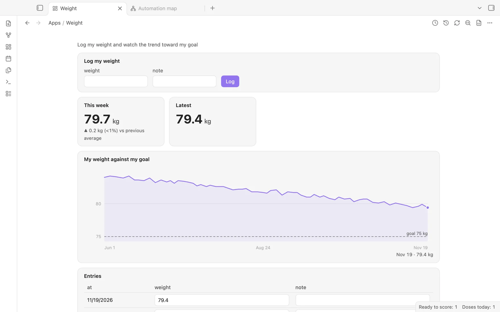
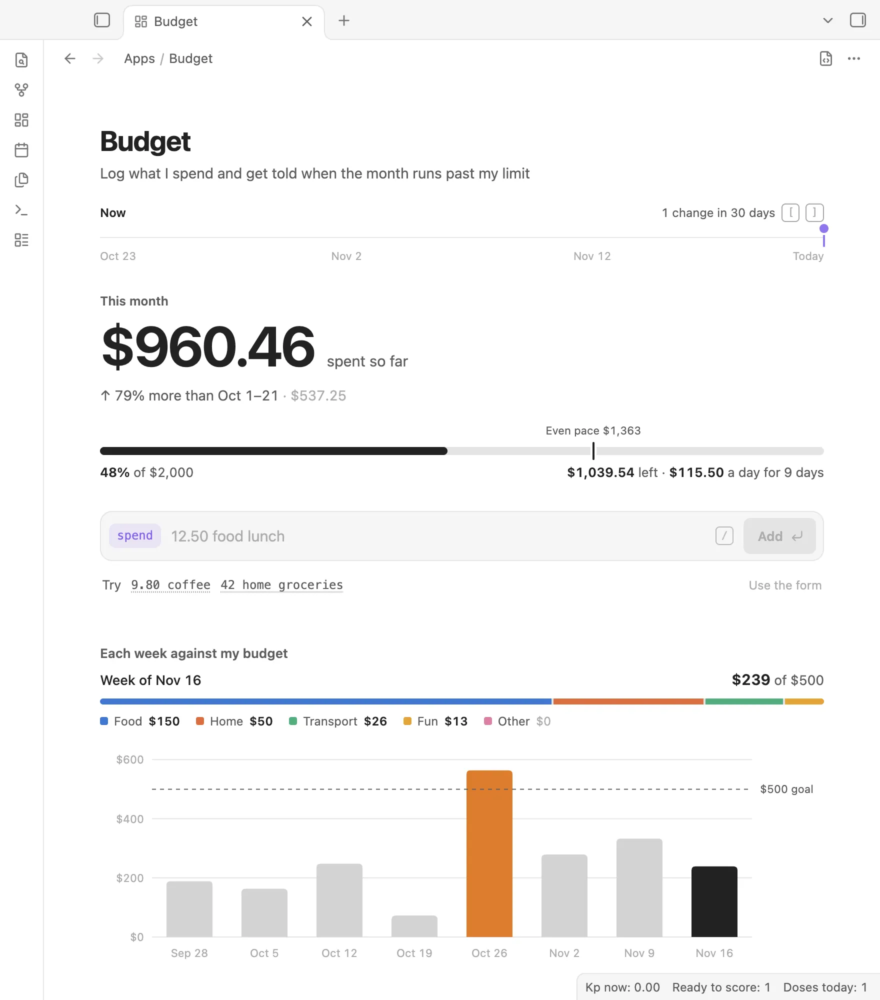
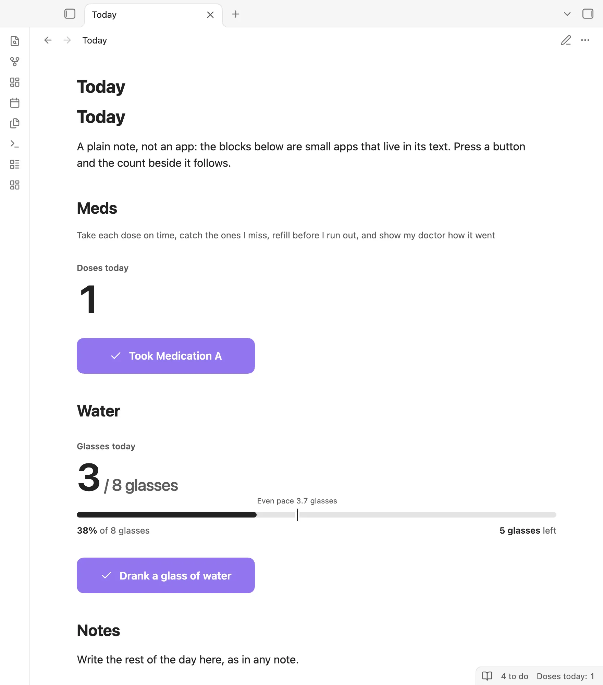

# Gizmo

**Type a few properties. Your note becomes an app.**

Gizmo is a plugin for Obsidian. It changes a note into a small app with buttons, forms, charts, boards and calendars. Your data stays in your vault, in notes that you can read. You do not write code.

```yaml
---
app: Log my weight and watch the trend toward my goal
use: "[[Tracker kit]]"
with: {what: weight, unit: kg, goal: 75}
---
```

These three lines make this app:

<picture>
  <source media="(prefers-color-scheme: dark)" srcset="docs/images/weight-dark.webp">
  
</picture>

## Why Gizmo

- **One plugin, many apps.** Each new app is a note, not a new plugin.
- **No code.** You type each key by hand. Gizmo examines the keys and shows each problem in clear words.
- **Your data stays in your vault.** Gizmo keeps it in Markdown notes that Bases and Dataview can read. There is no hidden database.
- **You give permission first.** An app tells you what it will read, download, send and change. It does not start until you select **Allow**.
- **Save from anywhere.** A hotkey, a line of text, a phone shortcut or a link can save data. The app does not have to be open.
- **Undo for your vault.** Gizmo keeps a log of each change that an app makes, and you can undo each one.

## What you can make

The gallery has apps that are ready to use. Run **Gizmo: New app from the gallery** to copy one into your vault.

<table>
  <tr>
    <td width="50%">
      <picture>
        <source media="(prefers-color-scheme: dark)" srcset="docs/images/medication-dark.webp">
        
      </picture>
      <b>Medication log.</b> One button for each dose, a streak and a calendar of the year.
    </td>
    <td width="50%">
      <picture>
        <source media="(prefers-color-scheme: dark)" srcset="docs/images/budget-dark.webp">
        
      </picture>
      <b>Budget.</b> The month total against your limit, and each week by category.
    </td>
  </tr>
  <tr>
    <td width="50%">
      <picture>
        <source media="(prefers-color-scheme: dark)" srcset="docs/images/board-dark.webp">
        
      </picture>
      <b>Project board.</b> Projects in columns by status, and their dates on a timeline.
    </td>
    <td width="50%">
      <picture>
        <source media="(prefers-color-scheme: dark)" srcset="docs/images/decisions-dark.webp">
        
      </picture>
      <b>Decision journal.</b> Write a decision now, give it a score later, and see how many were correct.
    </td>
  </tr>
</table>

The gallery also has Weight, Sleep, Household chores, Book finder, Task inbox, Trip planner, Watchlist, Aurora watch and Read later.

## Use it everywhere

<table>
  <tr>
    <td width="50%">
      <picture>
        <source media="(prefers-color-scheme: dark)" srcset="docs/images/today-dark.webp">
        
      </picture>
      <b>Inside a note.</b> A <code>gizmo</code> code block puts panels into the text of a note.
    </td>
    <td width="50%">
      <picture>
        <source media="(prefers-color-scheme: dark)" srcset="docs/images/capture-dark.webp">
        
      </picture>
      <b>From one line.</b> <b>Gizmo: Do…</b> saves <code>spend 14.5 food lunch</code> and shows the result first.
    </td>
  </tr>
</table>

Gizmo also adds board, calendar, timeline, chart and number views to Obsidian Bases. A value can stay in the status bar. A phone shortcut or a link can run an app, and `gizmod` does background work when Obsidian is closed.

## You stay in control

<table>
  <tr>
    <td width="50%">
      <picture>
        <source media="(prefers-color-scheme: dark)" srcset="docs/images/permission-dark.webp">
        
      </picture>
      <b>Permission first.</b> Each app asks before it starts. <b>Try it first</b> operates it on copies of your notes.
    </td>
    <td width="50%">
      <picture>
        <source media="(prefers-color-scheme: dark)" srcset="docs/images/map-dark.webp">
        
      </picture>
      <b>One map.</b> See what each app reads, downloads, sends and changes. Remove a permission with one click.
    </td>
  </tr>
</table>

A `Gizmo policy` note tells which notes are private and where their data can go. The activity log can undo each change, and **As of…** shows an app at a past time.

## Install

Gizmo 0.1.0 operates with Obsidian 1.11.4 or later, on desktop and on mobile.

1. Download `main.js`, `manifest.json` and `styles.css` from the [latest release](https://github.com/chauduyphanvu/obsidian-gizmo/releases/latest).
2. Put the three files in the folder `.obsidian/plugins/gizmo` of your vault.
3. In **Settings → Community plugins**, set the **Gizmo** toggle to on.
4. Run **Gizmo: New app from the gallery**.

## Learn more

The [reference](docs/reference.md) has the full details: how to write an app, all keys, views and sources, permissions, links, devices, `gizmod` and development.

```sh
npm install && npm run build && npm test
```
