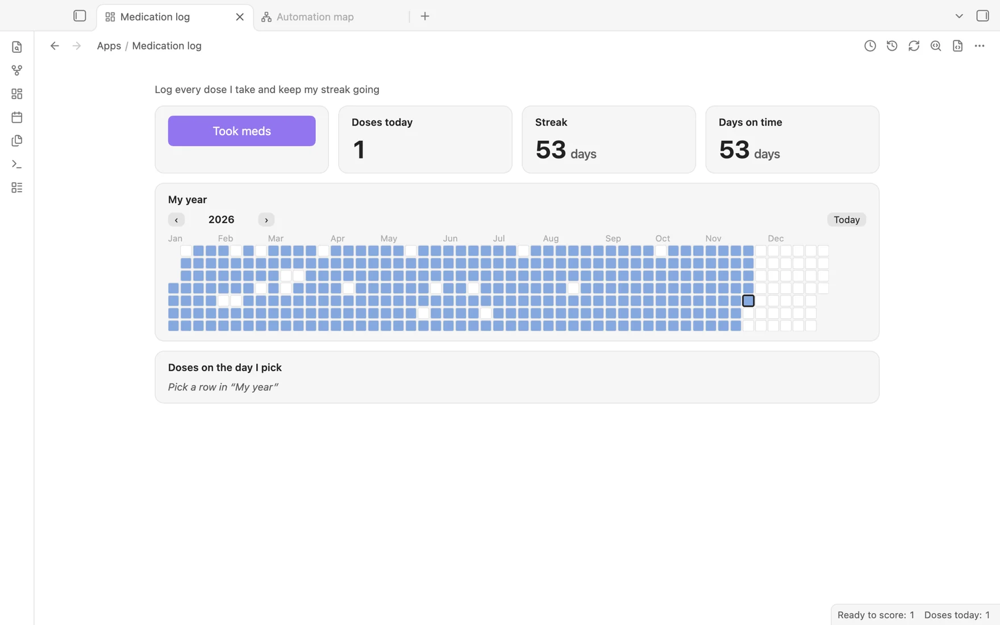
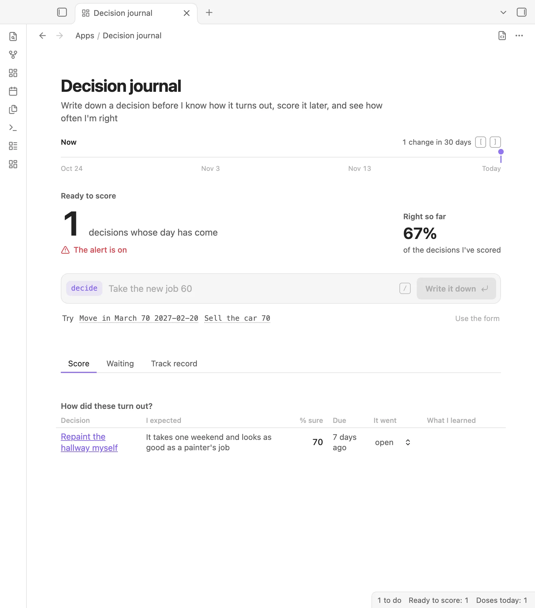
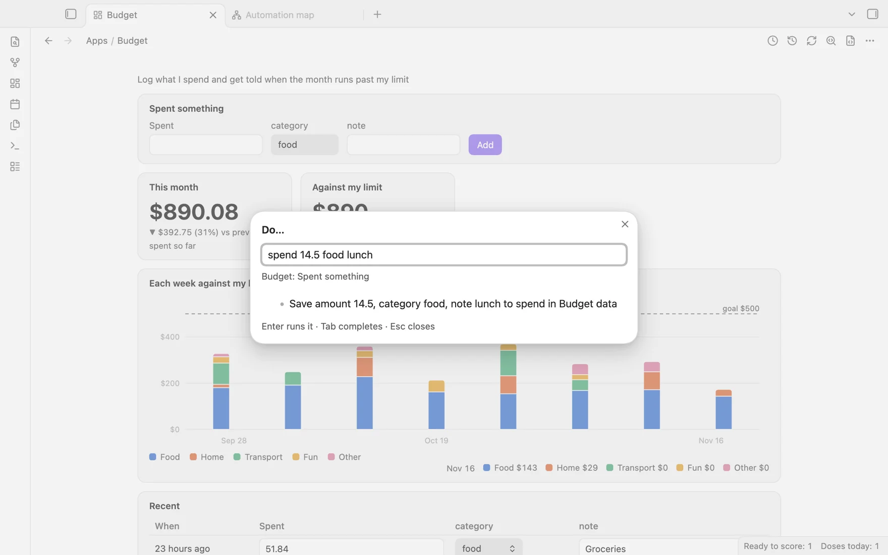
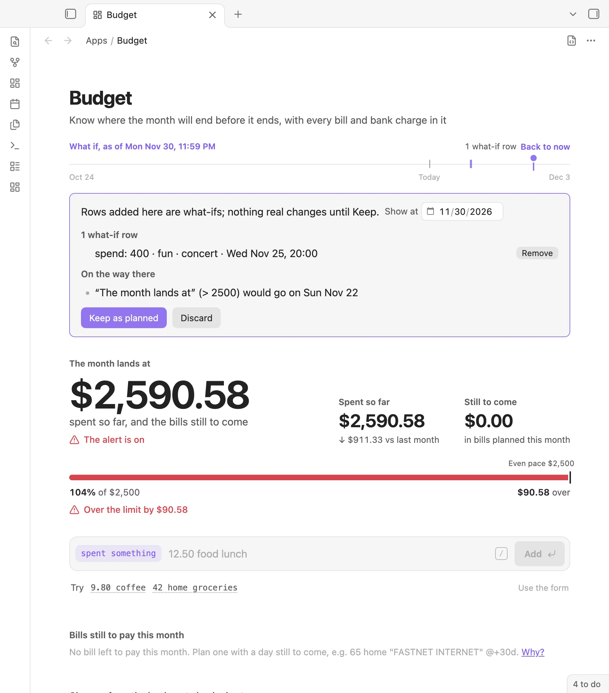
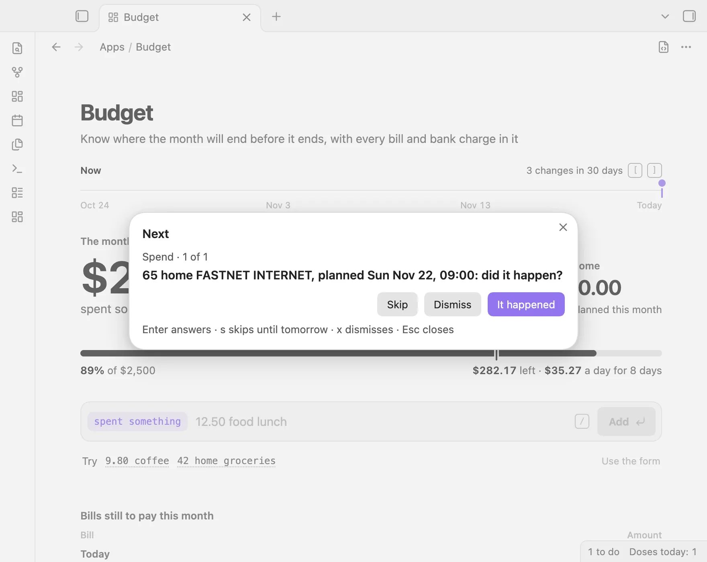
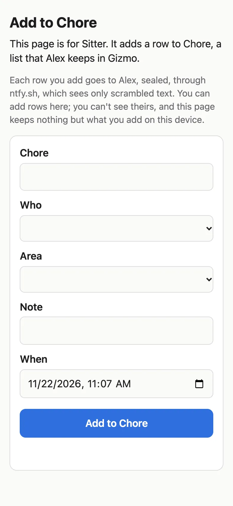
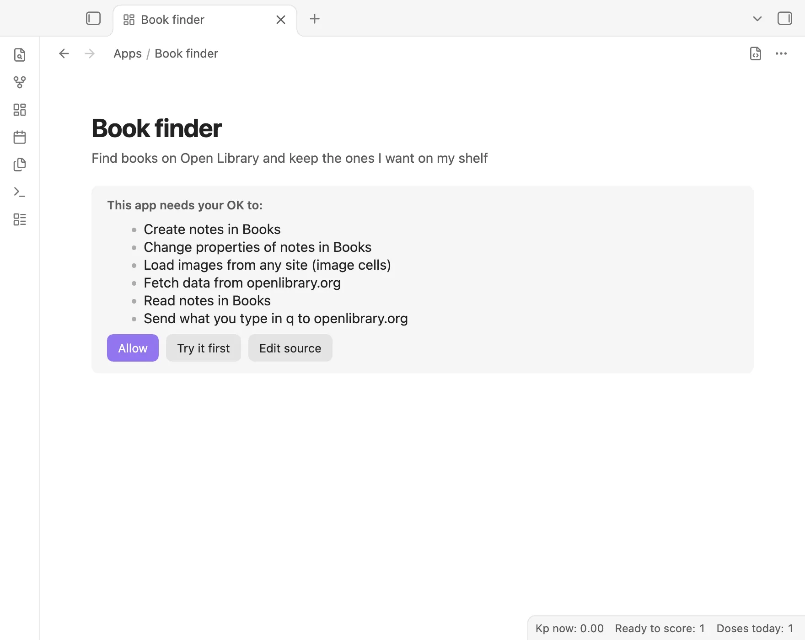
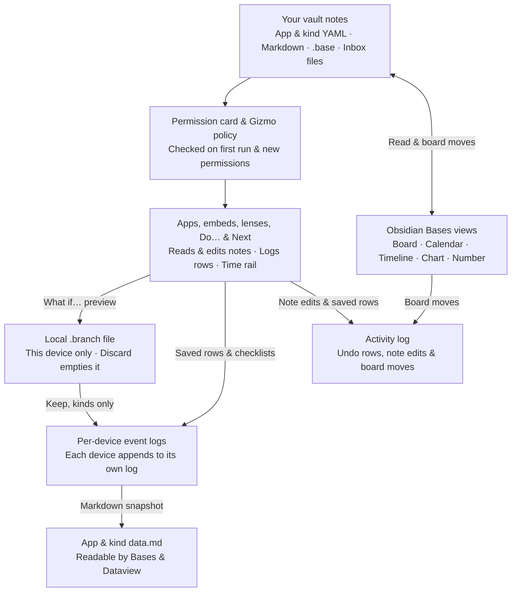
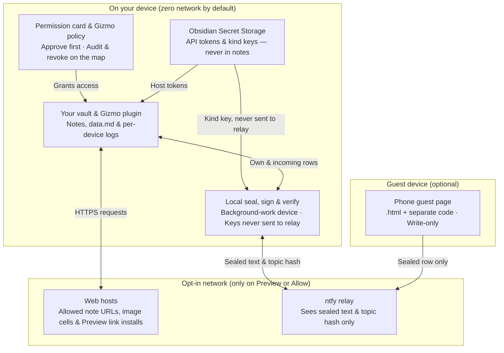

# Gizmo

**A note is an app.**

Gizmo turns ordinary Obsidian notes into personal apps — with buttons, forms, charts, boards, calendars, timelines, and five views for **Obsidian Bases**. Instead of installing a dozen single-purpose plugins or locking your life in a hidden database, every app you need is a plain Markdown note in your vault, with no code.

Desktop & mobile · Plain Markdown · Zero runtime dependencies · No AI · No telemetry · MIT

[**Install in Obsidian**](https://obsidian.md/plugins?id=gizmo) · [14 ready-made apps](#what-you-can-make) · [Bases views](#use-it-everywhere) · [How it works](#how-it-works-with-your-vault) · [Reference](docs/reference.md)

## Start in 30 seconds

1. **Copy a ready-made app** *(no YAML required)* — Run **Gizmo: New app from the gallery** to install any of 14 working apps.
2. **Add five views to Obsidian Bases** *(no YAML required)* — Open any `.base` file and pick **Gizmo board**, **Gizmo calendar** (month or year heatmap), **Gizmo timeline**, **Gizmo chart**, or **Gizmo number**.
3. **Or build your own in three lines** — Use a reusable kit, or ask a kind a question with `?` in **Gizmo: Do…** and let Gizmo write the panel for you.

Here is the Practice app in Obsidian:

<picture>
  <source media="(prefers-color-scheme: dark)" srcset="https://raw.githubusercontent.com/chauduyphanvu/obsidian-gizmo/main/docs/images/practice-dark.webp">
  
</picture>

All of that is one note, with three lines of properties:

```yaml
---
app: Log how long I practise and see this week against the last and the trend toward my goal
use: "[[Tracker kit]]"
with: {what: practice, unit: minutes, goal: 30}
---
```

## What you can make

The gallery ships with 14 apps ready to use. Run **Gizmo: New app from the gallery** to copy any of them into your vault.

<table>
  <tr>
    <td width="50%">
      <picture>
        <source media="(prefers-color-scheme: dark)" srcset="https://raw.githubusercontent.com/chauduyphanvu/obsidian-gizmo/main/docs/images/budget-dark.webp">
        
      </picture>
      <b>Budget.</b> Where the month will land against your limit, with each bill and bank charge in it.
    </td>
    <td width="50%">
      <picture>
        <source media="(prefers-color-scheme: dark)" srcset="https://raw.githubusercontent.com/chauduyphanvu/obsidian-gizmo/main/docs/images/medication-dark.webp">
        
      </picture>
      <b>Medication log.</b> A button for each medication, the doses due and missed, a refill countdown, and a summary for the doctor.
    </td>
  </tr>
  <tr>
    <td width="50%">
      <picture>
        <source media="(prefers-color-scheme: dark)" srcset="https://raw.githubusercontent.com/chauduyphanvu/obsidian-gizmo/main/docs/images/board-dark.webp">
        
      </picture>
      <b>Project board.</b> Projects in columns by status, and their dates on a timeline.
    </td>
    <td width="50%">
      <picture>
        <source media="(prefers-color-scheme: dark)" srcset="https://raw.githubusercontent.com/chauduyphanvu/obsidian-gizmo/main/docs/images/decisions-dark.webp">
        
      </picture>
      <b>Decision journal.</b> Write a decision now, give it a score later, and see how many were correct.
    </td>
  </tr>
</table>

Also included in the gallery: **Bills and renewals**, **Vitals**, **Practice**, **Household chores**, **Book finder**, **Task inbox**, **Trip planner**, **Trades**, **Aurora watch**, and **Read later**, built on six shared kinds (**Spend**, **Renewal**, **Dose**, **Measurement**, **Trade**, and **Chore**).

## One plugin instead of a dozen

- **Each new app is a note, not another plugin.** Budget, medication log, project board, habit tracker, chore schedule, trip planner — all run on Gizmo with one mental model and one settings screen.
- **Readable, validated properties — no JavaScript.** No scripts, no React, and no fragile CSS snippets. When a key has a typo, Gizmo explains the fix in plain words.
- **An answer, not a cluttered dashboard.** Gizmo lays out each app in one calm editorial column: headline figure, pace meter, single-line quick add, charts, date-grouped ledgers, and a 30-day time rail.
- **Your data stays in your vault.** Stored in plain Markdown notes that Obsidian Bases and Dataview can read, backed by per-device append-only event logs so iCloud, Syncthing, and Obsidian Sync don't clobber concurrent edits.
- **Permissions and undo built in.** Every app asks before it touches other notes, kinds, folders, secrets, or the web. **Try it first** runs any app in an isolated sandbox (reading none of your vault notes), and changes can be undone from the activity log.
- **Save from anywhere.** A hotkey, a one-line prompt (`spend 14.5 food lunch`), an inline `;;` line, a phone shortcut, or a URL can save data without opening the app.

| | Gizmo (1 plugin) | A stack of single-purpose plugins *(Dataview, Meta Bind, Tracker, Buttons, Kanban, Calendar…)* |
| --- | --- | --- |
| **Starting point** | 14 ready-made apps + `?` Ask generates panels from your kinds | Wire queries, inputs, buttons, and CSS by hand |
| **Mobile experience** | Built for desktop & phone (44 px touch targets, side sheets) | Varies by plugin and custom CSS |
| **Multi-device & history** | Per-device event logs, conflict preservation, 30-day time rail, activity log with Undo | Direct file edits with no unified history or undo |
| **Planning & simulation** | Planned rows, **What if…** previews (up to 1 year ahead) | No built-in What if… simulation or planned-vs-actual reconciliation |
| **Real-world data** | Bank / broker / health CSV, JSON & ICS import & reconciliation | Manual entry or external scripts |
| **Security** | Static permission cards, isolated **Try it first** sandbox, data policy | Arbitrary JS / unrestricted plugin access |
| **Obsidian Bases** | Adds board, calendar, timeline, chart, and number views | Requires separate view plugins |

## Use it everywhere

- **Obsidian Bases views:** Switch any `.base` file or embedded base block to a Gizmo view with no app note required — including drag-and-drop board moves that log to your activity history for Undo.
- **Embeds and lenses:** Drop a `gizmo` code block into a daily note to place live buttons, meters, or charts beside your writing, or attach a **lens** automatically to every note in a folder (such as reading progress on every book note).
- **Quick capture & shortcuts:** Log from anywhere with **Gizmo: Do…**, pin live metrics to the status bar, trigger apps from Apple Shortcuts / Raycast / Alfred, or run [`gizmod`](#gizmod) in the background when Obsidian is closed.

<table>
  <tr>
    <td width="50%">
      <picture>
        <source media="(prefers-color-scheme: dark)" srcset="https://raw.githubusercontent.com/chauduyphanvu/obsidian-gizmo/main/docs/images/today-dark.webp">
        
      </picture>
      <b>Inside a note.</b> A <code>gizmo</code> code block puts live panels right inside a plain note.
    </td>
    <td width="50%">
      <picture>
        <source media="(prefers-color-scheme: dark)" srcset="https://raw.githubusercontent.com/chauduyphanvu/obsidian-gizmo/main/docs/images/capture-dark.webp">
        
      </picture>
      <b>From one line.</b> <b>Gizmo: Do…</b> saves <code>spend 14.5 food lunch</code> and previews the row first.
    </td>
  </tr>
</table>

## Plan, reconcile, ask, and simulate

Gizmo goes beyond passive trackers when your data connects across apps and time.

<table>
  <tr>
    <td width="50%">
      <picture>
        <source media="(prefers-color-scheme: dark)" srcset="https://raw.githubusercontent.com/chauduyphanvu/obsidian-gizmo/main/docs/images/bank-dark.webp">
        
      </picture>
      <b>Check the bank.</b> Drop a bank CSV export into <code>Inbox/Bank</code>. Charges pair against what you logged and settle planned bills.
    </td>
    <td width="50%">
      <picture>
        <source media="(prefers-color-scheme: dark)" srcset="https://raw.githubusercontent.com/chauduyphanvu/obsidian-gizmo/main/docs/images/whatif-dark.webp">
        
      </picture>
      <b>What if…</b> Preview a $400 concert against your monthly budget and alerts before spending. Nothing real changes until you click <b>Keep as planned</b>.
    </td>
  </tr>
  <tr>
    <td width="50%">
      <picture>
        <source media="(prefers-color-scheme: dark)" srcset="https://raw.githubusercontent.com/chauduyphanvu/obsidian-gizmo/main/docs/images/ask-dark.webp">
        
      </picture>
      <b>Ask (<code>?</code>).</b> Type <code>? spend food per week since sep</code> to draw the answer live and save it directly into an app or embed.
    </td>
    <td width="50%">
      <picture>
        <source media="(prefers-color-scheme: dark)" srcset="https://raw.githubusercontent.com/chauduyphanvu/obsidian-gizmo/main/docs/images/next-dark.webp">
        
      </picture>
      <b>Next.</b> One focused prompt at a time for overdue bills, missed doses, bank files waiting to review, and new shared contributors.
    </td>
  </tr>
</table>

**Trust the numbers.** Click any figure, or press `=`, to see the exact rows behind it, where each row was written, and what moved it since last week. Type the figure you want and Gizmo solves for the planned amount that gets you there. Fields can carry units (`amount: USD`, `weight: kg`), so `1500 jpy` lands as dollars at the rate you set and a formula that adds dollars to yen is refused. A `;;` line in a daily note stays linked to its row: fix the sentence and the totals follow. **New app from lines…** turns a list you already keep into a kind and an app, and a sealed kind can export a file that proves when each row was written. Refer to [Explain a figure](docs/reference.md#explain-a-figure), [Units](docs/reference.md#units), [Lines are rows](docs/reference.md#lines-are-rows), [New app from lines](docs/reference.md#new-app-from-lines) and [Sealed records](docs/reference.md#sealed-records).

### One kind, many apps

A **kind** is a note with `kind` and `fields` whose rows belong to your vault, not to a single app. This is the gallery's Spend kind (shortened):

```yaml
---
kind: spend
shortcut: spend
fields:
  amount: {type: number, label: Spent, format: "$0,0.00"}
  category: [food, home, transport, fun, travel, other]
  note: text
import:
  bank: {folder: Inbox/Bank, at: Posted Date, amount: "-Amount", note: Description, where: {Amount: "< 0"}}
---
```

Apps read the rows with `source: "[[Spend]]"` and add rows with `save: "[[Spend]]"`. **Budget**, **Bills and renewals**, **Trip planner**, and **Household chores** all share Spend, so bills, travel costs, and home upkeep all count toward your monthly budget automatically.

- **Planned & imported rows:** Plan schedules with `@every month from 2026-12-01 until 2027-12-01`; logging or importing a matching charge settles the planned row and flags price rises. Refer to [Kinds](docs/reference.md#kinds) and [Match and reconcile](docs/reference.md#match-and-reconcile).
- **What if…:** Run **Gizmo: What if…** or prefix a **Do…** line with `what if` (such as `what if spend 900 travel flight @2026-12-03`) to test future alerts before committing. Refer to [What if](docs/reference.md#what-if).
- **The ask line (`?`):** Query any kind in **Do…** (such as `? spend by category this month`), then click **Add to an app…**, **Copy YAML**, or **Copy embed**. Refer to [The ask line](docs/reference.md#the-ask-line).
- **Next:** Click the status bar count or run **Gizmo: Next** and triage with `Enter` (confirm/accept), `s` (skip until tomorrow), or `x` (dismiss or refuse). Refer to [Next](docs/reference.md#next).

## Share a kind — even with people who don't use Obsidian

Two or more people can share a kind — such as household chores or a medication log — each in their own vault, sealed end-to-end through an [ntfy](https://ntfy.sh) server (public or self-hosted). Add `share` to the kind note (gallery notes like Chore and Dose include this line commented out with `#`):

```yaml
share: {relay: "https://ntfy.sh", key: {secret: chore-key}}
```

Run **Gizmo: Invite to a kind** to generate a key in Obsidian's secret storage and an `obsidian://gizmo?invite=…` link to send privately. Nothing leaves your vault until you select **Allow**, and rows from new writers wait in **Next** for your approval.

<table>
  <tr>
    <td width="40%">
      <picture>
        <source media="(prefers-color-scheme: dark)" srcset="https://raw.githubusercontent.com/chauduyphanvu/obsidian-gizmo/main/docs/images/guest-dark.webp">
        
      </picture>
    </td>
    <td width="60%">
      <b>Write-only guest pages.</b> Run <b>Gizmo: Make a guest page</b> to create a single standalone HTML file and a code. A sitter, partner, or caregiver opens it on their phone — no Obsidian and no account needed — and logs entries directly to your vault. The page cannot read any of your existing rows, and you can remove it with one click on the automation map.
      <br><br>
      Refer to <a href="docs/reference.md#shared-kinds">Shared kinds</a>, and to <a href="#network-and-files">Network and files</a> for what the relay sees.
    </td>
  </tr>
</table>

## You stay in control

<table>
  <tr>
    <td width="50%">
      <picture>
        <source media="(prefers-color-scheme: dark)" srcset="https://raw.githubusercontent.com/chauduyphanvu/obsidian-gizmo/main/docs/images/permission-dark.webp">
        
      </picture>
      <b>Permission first.</b> Each app lists everything it reads, fetches, sends, or writes before running. <b>Try it first</b> runs the app in an isolated sandbox — reading none of your vault notes and discarding everything when closed.
    </td>
    <td width="50%">
      <picture>
        <source media="(prefers-color-scheme: dark)" srcset="https://raw.githubusercontent.com/chauduyphanvu/obsidian-gizmo/main/docs/images/map-dark.webp">
        
      </picture>
      <b>One automation map.</b> Audit every app's permissions and every shared kind contributor in one place (or export it as a Canvas). Revoke app access or remove shared contributors with one click.
    </td>
  </tr>
</table>

A `Gizmo policy` note defines which folders or tags are private and which destinations may receive them. The activity log undoes changes, and **As of…** / the 30-day **time rail** lets you view an app at any past point.

## Install

Gizmo 0.4.1 works with Obsidian 1.11.4 or later, on desktop and mobile.

### From Obsidian Community Plugins (recommended)

1. Open [**Gizmo in Obsidian**](https://obsidian.md/plugins?id=gizmo), or go to **Settings → Community plugins → Browse** and search for **Gizmo**.
2. Select **Install**, then **Enable**.
3. Run **Gizmo: New app from the gallery** to copy a ready-made app, run **Gizmo: New app** to build your own, or open any `.base` file to use Gizmo's Bases views.

<details>
<summary>Manual installation from GitHub Releases</summary>

1. Download `main.js`, `manifest.json`, and `styles.css` from the [latest release](https://github.com/chauduyphanvu/obsidian-gizmo/releases/latest).
2. Place the three files in `.obsidian/plugins/gizmo` inside your vault.
3. In **Settings → Community plugins**, enable **Gizmo**.

</details>

## How it works with your vault

Everything stays in plain files inside your vault — readable by Obsidian Bases and Dataview, conflict-free across sync services, and gated by explicit permissions before an app touches other notes, kinds, or the network.



## Network and files

Gizmo has no telemetry, no account, and no update check. In Obsidian, it reads and writes only the files of your vault and its own plugin folder.



It makes network requests only in these cases:

- **A note names a web address**: a `source`, a feed, or a request that sends data. The app fetches only after you select **Allow**, the permission card names each host, and the automation map lists them all. For **image cells**, the URL comes from row data, so the permission card asks to load images from any `https://` site instead of naming individual hosts.
- **Install an app from a link or text** downloads the app from the URL you provide (for example a GitHub Gist) when you select **Preview**.
- **A shared kind** sends its rows to the ntfy server in its `share` key and reads the other members' rows from there. It does so only when the note has `share`, its secret holds the key, and you selected **Allow** on the kind note. No gallery note shares anything until you remove the `#` before its `share` line.
- **A sealed kind with an authority** (`seal: {authority: …}`) sends the 32-byte hash of its event logs to that time-stamp authority, once a day at most and when you ask, after you select **Allow** on the kind note. The hash reveals nothing about the rows. `seal: true` sends nothing.

These gallery apps use public services:

| App | Service |
| --- | --- |
| Aurora watch | NOAA Space Weather Prediction Center |
| Book finder | Open Library |
| Read later | NPR and BBC news feeds |
| Trip planner | Frankfurter (exchange rates) and Open-Meteo (weather) |
| Trades | Yahoo Finance |

**What the relay sees.** Gizmo seals each row with the key of the kind before it leaves your device. The relay sees the sealed text, its size, when messages arrive and are read, the device's IP address, and a topic derived from the key. It cannot read a row, its fields, the name of the kind, or your name, and it cannot alter a message. A guest page loads nothing from the web, and its CSP allows it to reach only the relay.

**The limits of sharing.**

- Each person with the key can read every row and add rows. Only a row's writer can edit or retract it; rows written by others show as theirs, and **Not mine** sets a row aside in your vault. The invite link holds the key, so send it only to the people you share with.
- **Remove** stops accepting rows from one signing key, in your vault only. It does not erase what that person already read, and they still hold the kind's key.
- To shut someone out completely, give `key` a new secret, run **Invite to a kind** to generate a new key, and re-invite the others.
- The public ntfy.sh keeps messages for about 12 hours. A vault that is offline longer catches up later from the hourly summaries each vault sends.

Refer to [What the relay and others can see](docs/reference.md#what-the-relay-and-others-can-see).

**Where your data is.**

| What | Where |
| --- | --- |
| Rows that an app saves | `<App> data.md` beside the app (or the note named in `store`), and a per-device log in `<App> data/log/`. |
| Rows of a kind | `<Kind> data.md` beside the kind note holds logged rows. `<Kind> data/log/` holds all logged, planned, imported, and dismissed rows, in per-device files. |
| What-if rows | A `.branch` file for this device in that log folder, until **Keep as planned** or **Discard**. |
| The key of a shared kind | Obsidian's secret storage, never a note. |
| A guest page | `<Kind> guest page (<name>).html` beside the kind note. Its code stays in the browser that uses it. |
| Shared-kind sync state, accepted writers, permissions, activity, and settings | The plugin folder (`.obsidian/plugins/gizmo/`). |

### gizmod

`gizmod` (`gizmod.mjs`, Node 20+) is optional and not part of the plugin. It is a separate Node.js script in each release and runs only if you start it. It works outside Obsidian:

- It reads and writes the vault folder on disk when Obsidian is closed (and takes priority for background work when running).
- It keeps its state in `~/.config/gizmod`.
- `node gizmod.mjs install --vault <path>` adds a macOS launchd agent that starts at login and writes logs to `~/Library/Logs`. `node gizmod.mjs uninstall` removes it.
- It answers HTTP on port 7468 (localhost and Tailscale) so a phone shortcut can run an app. Remote requests require a shortcut key, capture key, or one-time push token; unauthenticated requests are rejected.
- It sends alerts to your phone through [ntfy](https://ntfy.sh) only if you set `GIZMOD_NTFY_URL`.
- It syncs a shared kind through its relay only if you allowed that kind in Obsidian and pass its key in `GIZMO_SECRET_<ID>`.

## Learn more

The [reference](docs/reference.md) has the full details: how to write an app, all keys, views and sources, kinds and shared kinds, permissions, links, devices, `gizmod`, all commands, and development.

```sh
npm install && npm run build && npm test
```
